# TheFrameVanced

삼성 더 프레임 TV를 날씨와 시간이 느껴지는 디지털 액자로 바꿉니다.

Turns a Samsung The Frame TV into a living digital frame: it picks images that match the local weather, time of day and season, prints a small caption, and shows them in Art Mode.

> **TV 연결은 [xchwarze/samsung-tv-ws-api](https://github.com/xchwarze/samsung-tv-ws-api)로 합니다.**
> 아트모드 접속, 이미지 업로드, 작품 표시, 삭제를 포함한 TV 통신은 모두 이 라이브러리(`samsungtvws`, LGPL-3.0)가 처리합니다. 이 프로젝트는 그 위에 이미지 선택과 합성, 자동 교체, 관리 페이지를 더한 것입니다. 훌륭한 라이브러리를 공개해 준 xchwarze와 기여자들께 감사드립니다.

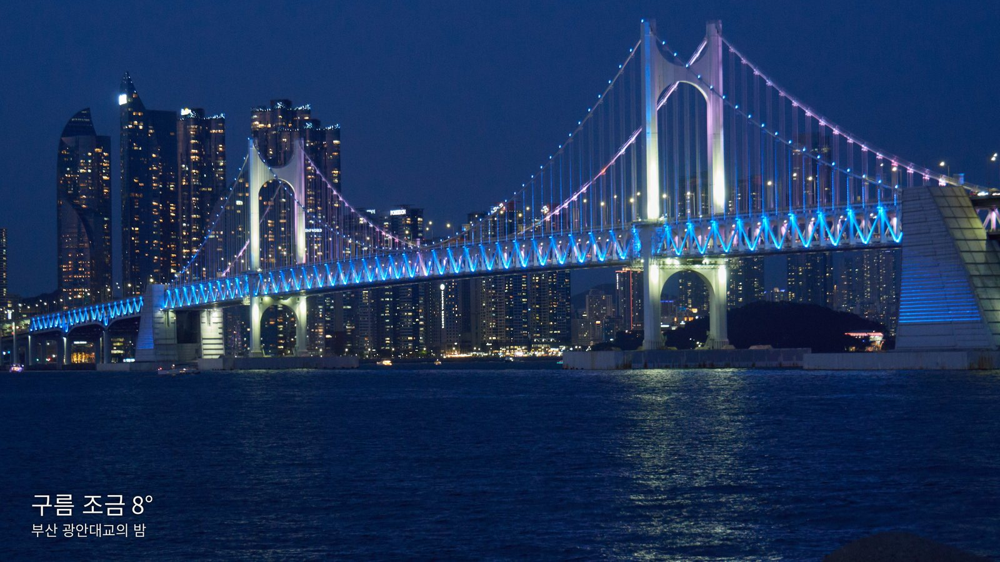

## 화면

### TV에 표시되는 모습

| 새벽 | 밝은 배경에는 검은 글자 |
|---|---|
|  | 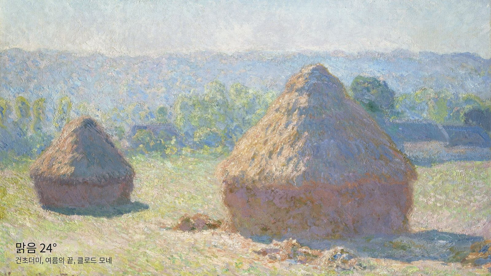 |

| 명화는 자르지 않고 벽에 건 모습으로 | 도쿄의 밤 |
|---|---|
| 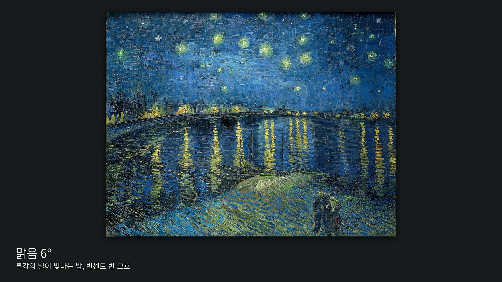 | 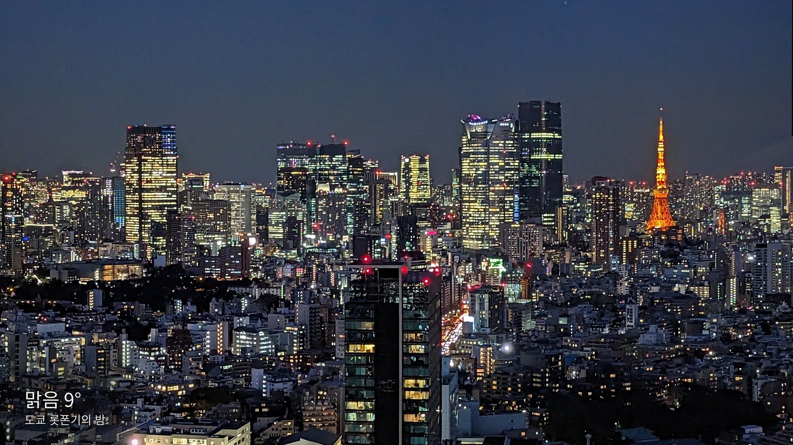 |

| 우주에서 본 오로라 | 절기를 넣은 예시 |
|---|---|
| 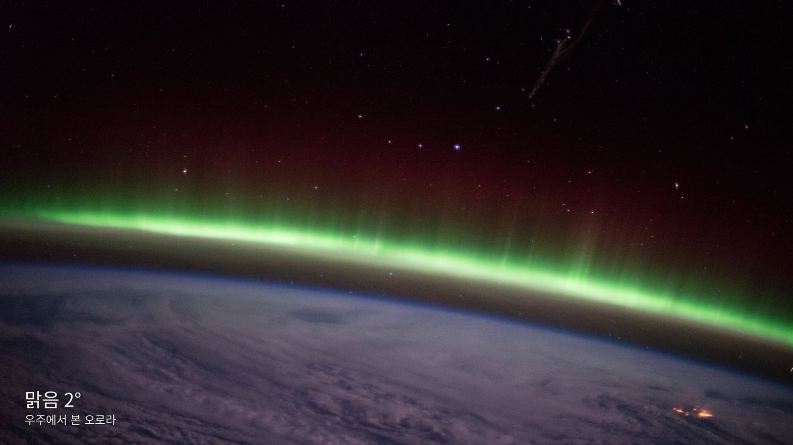 | 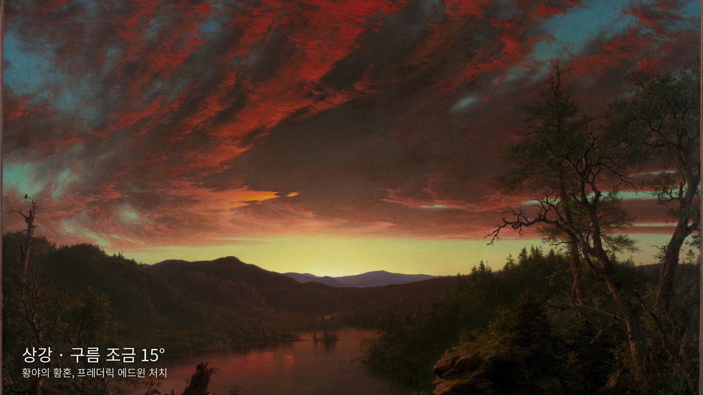 |

### 관리 페이지

시간대를 고르면 벽 조명이 함께 바뀌고, 글자는 액자 위에서 직접 끌어 옮깁니다.

| 글자 설정 | 글자 끌어서 옮기기 |
|---|---|
| 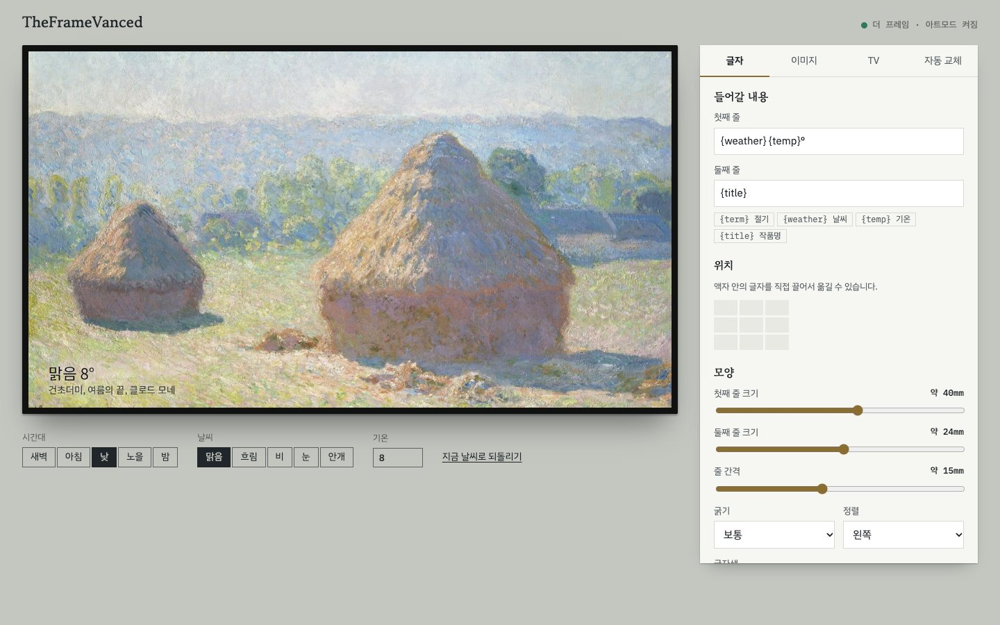 | 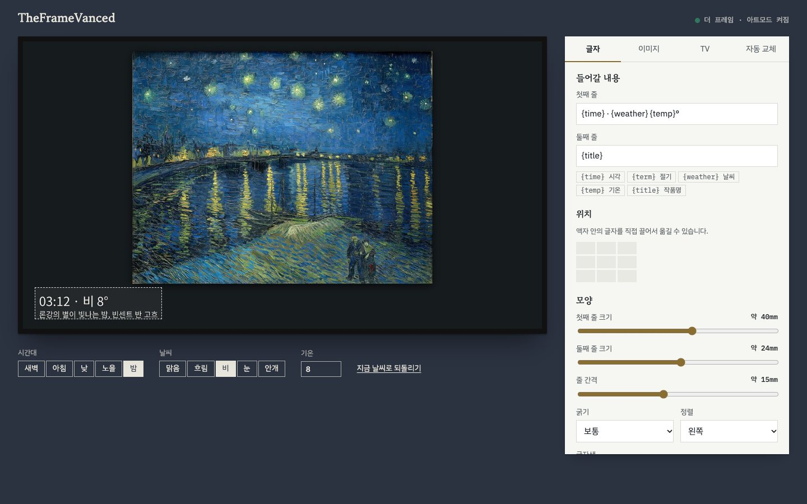 |

| 테마 고르기 | 이미지 소스 추가 |
|---|---|
| 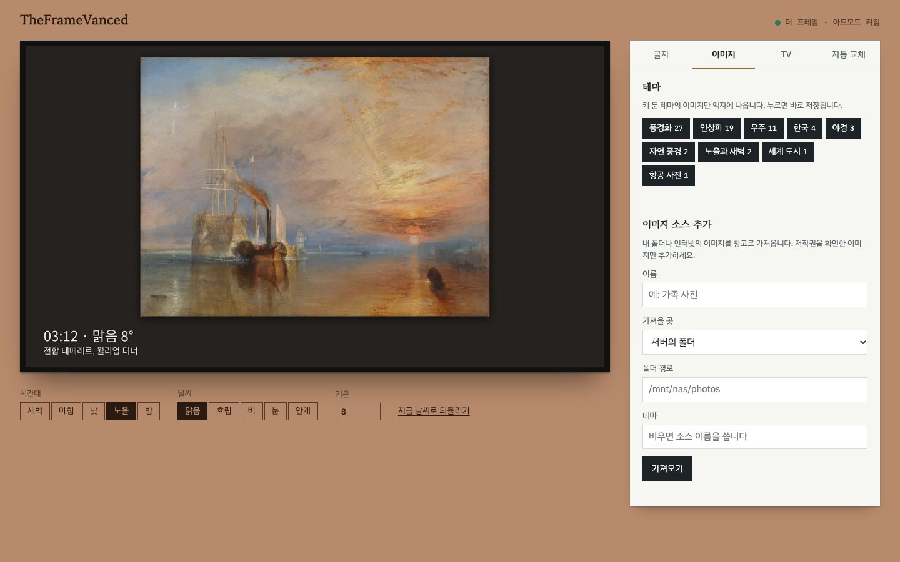 | 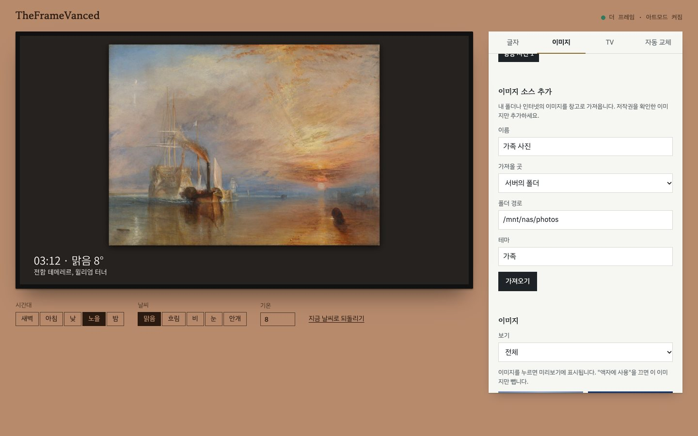 |

| TV 연결 | 지역과 자동 교체 |
|---|---|
| 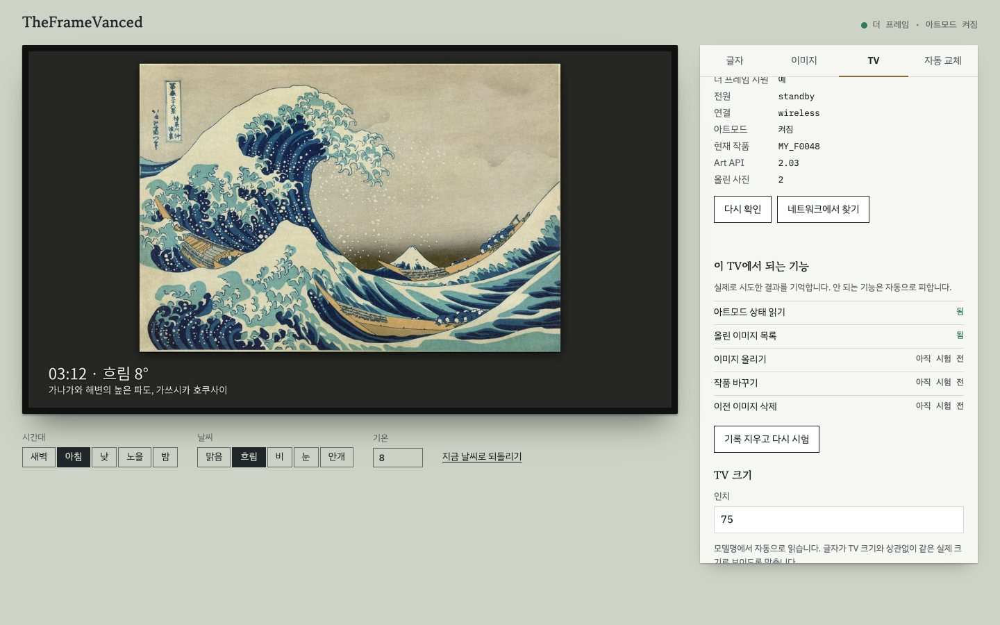 | 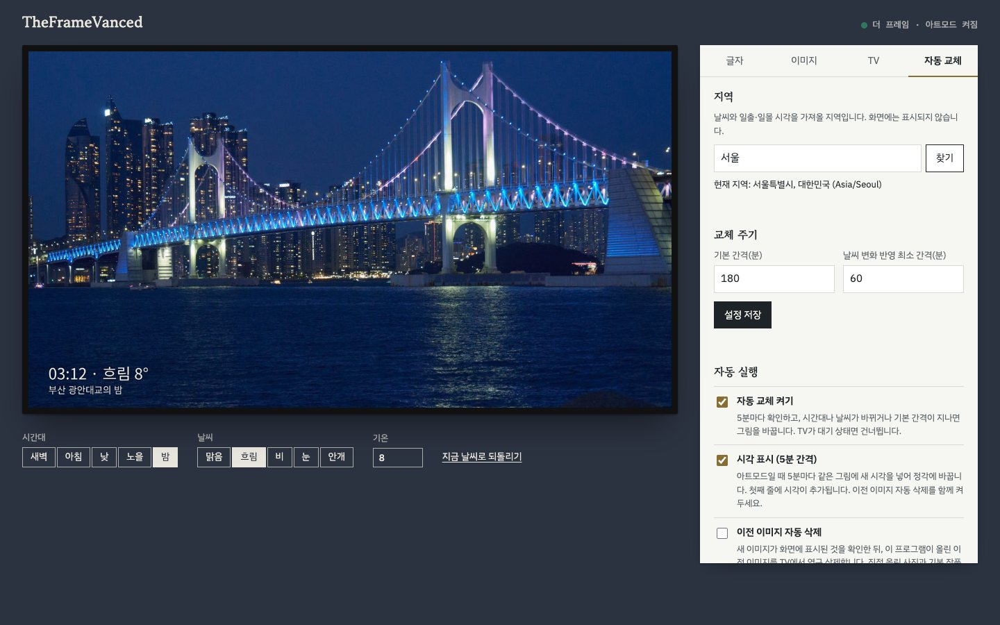 |

휴대폰에서도 쓸 수 있습니다.

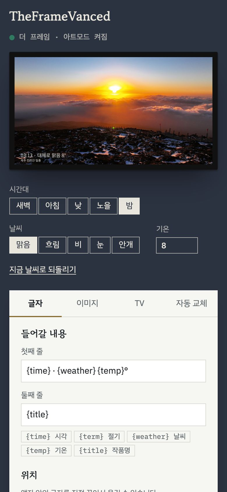

## 무엇을 하나요

- 10분마다 지금 시간대와 날씨를 확인합니다.
- 시간대나 날씨가 바뀌거나 정해 둔 간격(기본 3시간)이 지나면 어울리는 이미지로 바꿉니다.
- 이미지에 날씨, 기온, 작품명을 작게 넣습니다.
- 글자가 놓일 자리의 밝기를 재서, 밝으면 검은 글자로 바꿉니다.
- TV 크기를 모델명에서 읽어, 어떤 인치에서도 글자가 같은 실제 크기로 보이게 합니다.
- 명화는 자르지 않고 어두운 벽에 건 모습으로 보여 줍니다.
- 테마를 골라 원하는 이미지만 나오게 하고, 내 폴더나 인터넷의 이미지를 직접 추가할 수 있습니다.
- TV를 시청 중이면 화면을 건드리지 않고, TV가 꺼져 있으면 깨우지 않습니다.

## 준비물

- 아트모드를 지원하는 삼성 더 프레임 TV ([지원 범위](#지원하는-tv) 참고)
- TV와 같은 네트워크에 있는 Linux 서버
- Python 3.10 이상, `systemd`, Noto Sans CJK 글꼴 (`fonts-noto-cjk`)

글꼴 경로는 Ubuntu 기준으로 `frame.py`의 `FONT_PATHS`에 들어 있습니다. 다른 배포판이면 이 값을 바꾸세요.

## 설치

```bash
git clone https://github.com/dicebattle/TheFrameVanced.git /tmp/TheFrameVanced
/tmp/TheFrameVanced/install.sh
```

`~/TheFrameVanced`에 설치하고 관리 페이지 서비스를 켭니다. 다른 위치에 설치하려면 `THEFRAMEVANCED_ROOT`를 지정하세요.

| 위치 | 내용 |
|---|---|
| `versions/` | 설치된 버전들 |
| `current` | 지금 쓰는 버전을 가리키는 링크 |
| `data/` | 설정, 이미지, 실행 기록. 업데이트해도 그대로입니다 |
| `.venv/` | Python 환경 |

이미지를 내려받습니다. 소스별 요청 제한을 지키느라 시간이 걸릴 수 있습니다. 다시 실행하면 이어서 받습니다.

```bash
cd ~/TheFrameVanced
.venv/bin/python current/tools/build_library.py current/library/manifest.json data/library
```

## 데몬으로 실행하기

별도의 상주 프로그램을 직접 띄울 필요 없이, `systemd` 사용자 서비스로 돌아갑니다. 서버를 재부팅해도 자동으로 다시 시작합니다.

| 서비스 | 하는 일 |
|---|---|
| `theframevanced.timer` | 10분마다 `theframevanced.service`를 실행 |
| `theframevanced.service` | 교체가 필요한지 판단하고 TV에 반영한 뒤 종료 |
| `theframevanced-admin.service` | 관리 페이지를 계속 실행 |
| `theframevanced-update.timer` | 하루 한 번 새 버전 확인 |

로그아웃한 뒤에도 서비스가 돌도록 한 번만 실행해 주세요. 자동 교체는 관리 페이지의 `자동 교체 켜기`로 켜고 끕니다.

```bash
loginctl enable-linger "$USER"
```

자주 쓰는 명령입니다.

```bash
systemctl --user status theframevanced.timer theframevanced-admin.service
journalctl --user -u theframevanced -f
systemctl --user disable --now theframevanced.timer
systemctl --user restart theframevanced-admin.service
```

순서대로 상태 확인, 실행 기록 보기, 자동 교체 끄기, 관리 페이지 다시 시작입니다.

서비스 없이 직접 실행할 수도 있습니다.

```bash
cd ~/TheFrameVanced
.venv/bin/python current/frame.py --data data --dry-run --force
.venv/bin/python current/frame.py --data data --force
```

`--dry-run`은 TV에 보내지 않고 `data/output/preview.jpg`만 만듭니다. `--force`는 조건과 상관없이 지금 교체합니다. `--image 이미지ID`로 특정 이미지를 고를 수 있습니다.

## 업데이트

`자동 교체` 탭의 `버전`에서 새 버전을 확인하고 설치합니다. `자동 업데이트`를 켜면 하루 한 번 스스로 설치합니다. 기본값은 꺼짐입니다.

```bash
~/TheFrameVanced/.venv/bin/python ~/TheFrameVanced/current/updater.py --check
~/TheFrameVanced/.venv/bin/python ~/TheFrameVanced/current/updater.py --install
```

설치는 이 순서로 진행되고, 지금 쓰는 버전은 마지막까지 그대로 둡니다.

1. [GitHub 릴리즈](https://github.com/dicebattle/TheFrameVanced/releases)에서 새 버전을 받아 체크섬을 확인합니다.
2. 별도 폴더에 풀고 필요한 패키지를 설치합니다.
3. 새 버전의 테스트를 돌립니다. 실패하면 여기서 멈춥니다.
4. `current`를 새 버전으로 바꾸고 관리 페이지를 다시 시작합니다.
5. 관리 페이지가 응답하지 않으면 이전 버전으로 되돌립니다.

체크섬은 파일이 손상되지 않았는지 확인할 뿐, 릴리즈를 만든 사람을 증명하지는 않습니다. 자동 업데이트는 이 저장소의 릴리즈를 믿는다는 뜻이니, 원하지 않으면 끈 채로 직접 설치하세요.

### 릴리즈 만들기

`VERSION` 파일을 올리고 같은 버전의 태그를 올리면 GitHub Actions가 테스트 후 릴리즈를 만듭니다.

```bash
git tag v0.2.0
git push origin v0.2.0
```

## 관리 페이지

시간대를 고르면 벽 조명이 함께 바뀌고, 글자는 액자 위에서 직접 끌어 옮깁니다.

| 글자 설정 | 글자 끌어서 옮기기 |
|---|---|
|  |  |

| 테마 고르기 | 이미지 소스 추가 |
|---|---|
|  |  |

| TV 연결 | 지역과 자동 교체 |
|---|---|
|  |  |

휴대폰에서도 쓸 수 있습니다.


## 무엇을 하나요

- 10분마다 지금 시간대와 날씨를 확인합니다.
- 시간대나 날씨가 바뀌거나 정해 둔 간격(기본 3시간)이 지나면 어울리는 이미지로 바꿉니다.
- 이미지에 날씨, 기온, 작품명을 작게 넣습니다.
- 글자가 놓일 자리의 밝기를 재서, 밝으면 검은 글자로 바꿉니다.
- TV 크기를 모델명에서 읽어, 어떤 인치에서도 글자가 같은 실제 크기로 보이게 합니다.
- 명화는 자르지 않고 어두운 벽에 건 모습으로 보여 줍니다.
- 테마를 골라 원하는 이미지만 나오게 하고, 내 폴더나 인터넷의 이미지를 직접 추가할 수 있습니다.
- TV를 시청 중이면 화면을 건드리지 않고, TV가 꺼져 있으면 깨우지 않습니다.

## 준비물

- 아트모드를 지원하는 삼성 더 프레임 TV ([지원 범위](#지원하는-tv) 참고)
- TV와 같은 네트워크에 있는 Linux 서버
- Python 3.10 이상, `systemd`, Noto Sans CJK 글꼴 (`fonts-noto-cjk`)

글꼴 경로는 Ubuntu 기준으로 `frame.py`의 `FONT_PATHS`에 들어 있습니다. 다른 배포판이면 이 값을 바꾸세요.

## 설치

```bash
git clone https://github.com/dicebattle/TheFrameVanced.git ~/TheFrameVanced
cd ~/TheFrameVanced
python3 -m venv .venv
.venv/bin/pip install -r requirements.txt
mkdir -p data/library
cp config.example.json data/config.json
```

이미지를 내려받습니다. 소스별 요청 제한을 지키느라 시간이 걸릴 수 있습니다. 다시 실행하면 이어서 받습니다.

```bash
.venv/bin/python tools/build_library.py library/manifest.json data/library
```

## 데몬으로 실행하기

별도의 상주 프로그램을 직접 띄울 필요 없이, `systemd` 사용자 서비스로 돌아갑니다. 서버를 재부팅해도 자동으로 다시 시작합니다.

| 서비스 | 하는 일 |
|---|---|
| `theframevanced.timer` | 10분마다 `theframevanced.service`를 실행 |
| `theframevanced.service` | 교체가 필요한지 판단하고 TV에 반영한 뒤 종료 |
| `theframevanced-admin.service` | 관리 페이지를 계속 실행 |

처음 한 번만 등록합니다.

```bash
mkdir -p ~/.config/systemd/user
cp systemd/* ~/.config/systemd/user/
systemctl --user daemon-reload
systemctl --user enable --now theframevanced-admin.service theframevanced.timer
loginctl enable-linger "$USER"
```

`loginctl enable-linger`는 로그아웃한 뒤에도 서비스가 돌도록 합니다. 타이머는 관리 페이지의 `자동 교체 켜기`로도 켜고 끌 수 있습니다.

자주 쓰는 명령입니다.

```bash
systemctl --user status theframevanced.timer theframevanced-admin.service
journalctl --user -u theframevanced -f
systemctl --user disable --now theframevanced.timer
systemctl --user restart theframevanced-admin.service
```

순서대로 상태 확인, 실행 기록 보기, 자동 교체 끄기, 관리 페이지 다시 시작입니다.

서비스 없이 직접 실행할 수도 있습니다.

```bash
.venv/bin/python frame.py --data data --dry-run --force
.venv/bin/python frame.py --data data --force
```

`--dry-run`은 TV에 보내지 않고 `data/output/preview.jpg`만 만듭니다. `--force`는 조건과 상관없이 지금 교체합니다. `--image 이미지ID`로 특정 이미지를 고를 수 있습니다.

## 관리 페이지

관리 페이지에는 로그인이 없어서 서버의 `127.0.0.1:8765`에서만 열립니다. 다른 컴퓨터에서는 SSH 터널로 여세요.

```bash
ssh -N -L 8765:127.0.0.1:8765 사용자@서버주소
```

그다음 http://127.0.0.1:8765 를 엽니다.

1. `TV` 탭에서 `네트워크에서 찾기`로 TV를 고릅니다.
2. `자동 교체` 탭에서 지역 이름을 찾습니다. 좌표와 시간대는 자동으로 맞춰집니다.
3. `글자` 탭에서 글자를 끌어 위치를 정합니다.
4. `자동 교체` 탭에서 `자동 교체 켜기`를 켭니다.

## 글자에 넣을 수 있는 값

`글자` 탭의 두 줄에 아래 값을 자유롭게 넣을 수 있습니다. 기본값은 `{weather} {temp}°`와 `{title}`입니다.

| 값 | 내용 | 예 |
|---|---|---|
| `{weather}` | 날씨 | 구름 조금 |
| `{temp}` | 기온 | 12 |
| `{title}` | 작품명 또는 사진 제목 | 론강의 별이 빛나는 밤, 빈센트 반 고흐 |
| `{term}` | 24절기 | 상강 |
| `{location}` | 지역 이름 | 서울 |

## 이전 이미지 자동 삭제

글자를 넣으려면 교체할 때마다 새 이미지를 TV에 올려야 해서, 그대로 두면 TV 저장 공간이 찹니다. `자동 교체` 탭의 `이전 이미지 자동 삭제`를 켜면 새 이미지 표시를 확인한 뒤 이전 이미지를 지웁니다.

- TV에는 휴지통이 없어 영구 삭제됩니다.
- 이 프로그램이 올린 이미지만 지웁니다. 직접 올린 사진과 기본 작품은 지우지 않습니다.
- 기본값은 꺼짐입니다.

## 지원하는 TV

아트모드가 있는 더 프레임 TV라면 연식과 상관없이 동작하도록 만들었습니다. 다만 직접 시험한 기종은 하나뿐입니다.

| 기종 | Art API | 상태 |
|---|---|---|
| 2021년형 LS03A | 2.03 | 직접 시험: 업로드, 작품 변경, 삭제, 자동 교체 |
| 2024년형 LS03F | 5.0.0.0 | 미시험. 라이브러리 이슈 [#166](https://github.com/xchwarze/samsung-tv-ws-api/issues/166)에 업로드 사례가 있습니다 |
| 2025년형 LS03F | 미확인 | 미시험. 라이브러리 이슈 [#185](https://github.com/xchwarze/samsung-tv-ws-api/issues/185)에 사용 사례가 있습니다 |
| 구형 | 0.97 | 미시험. 라이브러리에 전용 업로드 경로가 있습니다 |
| 일반 삼성 TV | 없음 | 불가. 아트모드 기능이 없습니다 |

TV마다 다른 부분은 자동으로 맞춥니다.

| 항목 | 동작 |
|---|---|
| TV 인식 | 더 프레임이 아니면 TV에 아무것도 보내지 않고 안내합니다 |
| 해상도 | TV의 해상도가 4K보다 낮으면 그 크기로 만들어 보냅니다 |
| 글자 크기 | 모델명에서 인치를 읽어 맞춥니다. 작은 TV는 1.8배까지만 키웁니다 |
| 사진 목록 | 분류 ID가 다른 기종이면 전체 목록에서 찾습니다 |
| 업로드 | 저장은 됐는데 완료 응답이 없으면 목록을 다시 읽어 찾아냅니다 |
| 작품 변경 | 표시를 확인하지 못하면 이전 이미지를 지우지 않습니다 |
| 삭제 | 응답 대신 TV에 실제로 남은 이미지로 판단합니다. 실패하면 자동으로 끕니다 |

관리 페이지 `TV` 탭의 `이 TV에서 되는 기능`에서 기능마다 `됨`, `안 됨`, `확인 못 함`, `아직 시험 전`을 볼 수 있습니다. `기록 지우고 다시 시험`을 누르면 꺼졌던 기능을 다시 시도합니다.

다른 TV를 쓰신다면 결과를 알려 주세요. 아래 명령의 출력을 [TV 호환성 보고](https://github.com/dicebattle/TheFrameVanced/issues/new?template=tv-report.md)로 보내 주시면 표에 추가합니다. TV 주소는 출력되지 않습니다.

```bash
~/TheFrameVanced/.venv/bin/python -W ignore ~/TheFrameVanced/current/frame.py --data ~/TheFrameVanced/data --report
```

## 테마 고르기

`이미지` 탭에서 테마를 누르면 바로 저장되고, 다음 교체부터 켜 둔 테마의 이미지만 나옵니다. 이미지 하나만 빼고 싶으면 이미지 아래의 `액자에 사용`을 끄세요.

기본 테마는 야경, 세계 도시, 한국, 항공 사진, 자연 풍경, 노을과 새벽, 우주, 인상파, 풍경화입니다. 이미지 하나가 여러 테마에 속할 수 있고, 그중 하나라도 켜져 있으면 나옵니다.

## 내 이미지 소스 추가하기

`이미지` 탭의 `이미지 소스 추가`에서 세 가지 방식으로 가져올 수 있습니다. 이미지는 창고로 복사되므로, 원본 폴더나 사이트가 사라져도 액자는 계속 동작합니다.

| 가져올 곳 | 입력 | 예 |
|---|---|---|
| 서버의 폴더 | 폴더 경로. 하위 폴더까지 읽습니다 | `/mnt/nas/photos` |
| 이미지 주소 한 개 | 이미지 파일 주소 | `https://example.com/photo.jpg` |
| 목록 주소 | 아래 형식의 JSON 파일 주소 | `https://example.com/images.json` |

폴더에 사진을 더 넣었다면 `다시 가져오기`를 누르세요. 새 이미지만 가져옵니다. `소스 빼기`는 창고에 복사된 이미지만 지우고 원본은 건드리지 않습니다.

목록 파일은 다른 사람과 이미지 묶음을 나눌 때 쓰기 좋습니다. `url`만 필수이고 나머지는 생략할 수 있습니다.

```json
[
  {
    "url": "https://example.com/seoul-night.jpg",
    "caption": "서울의 밤",
    "kind": "photo",
    "times": ["sunset", "night"],
    "seasons": ["any"],
    "weather": ["clear", "cloud"],
    "themes": ["야경"],
    "license": "CC0",
    "artist": "작가 이름"
  }
]
```

- `kind`: `photo` 또는 `painting`
- `times`: `dawn`, `morning`, `day`, `sunset`, `night`, `any`
- `seasons`: `spring`, `summer`, `autumn`, `winter`, `any`
- `weather`: `clear`, `cloud`, `rain`, `snow`, `fog`, `any`
- `fit`: `mat`이면 자르지 않고 벽에 건 모습으로 보여 줍니다. 비우면 화면에 맞춰 자릅니다.

인터넷의 목록은 믿을 수 없는 데이터로 취급합니다. 알려진 항목만 읽고, 파일 이름은 프로그램이 정하며, 실제 이미지로 읽히는 파일만 저장합니다. 저작권을 확인한 이미지만 추가하세요.

## 기본 이미지

저장소에는 이미지 파일이 없고, 출처 목록 `library/manifest.json`만 있습니다. 항목마다 원본 주소, 제공처, 작가, 라이선스가 들어 있고, `tools/build_library.py`가 이 목록대로 내려받습니다. 기본 목록은 108장입니다.

| 소스 | 내용 | 장수 | 라이선스 |
|---|---|---:|---|
| [Wikimedia Commons](https://commons.wikimedia.org/) | 풍경, 도시 주·야경, 항공 사진, 명화 | 73 | 사진마다 다름 |
| [National Gallery of Art](https://www.nga.gov/open-access-images.html) | 명화 | 18 | CC0 |
| [NASA Image and Video Library](https://images.nasa.gov/) | 우주에서 본 도시와 오로라 | 11 | 공개 도메인 |
| [Cleveland Museum of Art](https://www.clevelandart.org/open-access) | 명화 | 6 | CC0 |

공개 소스에서 새 후보를 찾으려면 수집 도구를 쓰세요. 번호를 붙인 썸네일 모음과 `candidates.json`을 만들어 주니, 직접 보고 고른 항목을 목록에 추가하면 됩니다.

```bash
cd ~/TheFrameVanced
.venv/bin/python current/tools/collect_candidates.py candidates commons skylines nasa nga cleveland met
```

- [The Metropolitan Museum of Art](https://metmuseum.github.io/) 수집도 지원하지만, 시험 때 요청이 403으로 막혀 기본 목록에는 넣지 않았습니다.
- 라이선스는 이미지마다 다릅니다. 이미지를 공개하거나 재배포할 때는 해당 조건을 지키세요. CC BY와 CC BY-SA 사진은 작가 표시가 필요합니다.

## 외부로 보내는 정보

| 서비스 | 보내는 내용 | 시점 |
|---|---|---|
| [Open-Meteo](https://open-meteo.com/) | 설정한 지역의 좌표 | 10분마다, 지역을 정할 때 |
| [OpenStreetMap Nominatim](https://nominatim.org/) | 입력한 지역 이름 | `찾기`를 누를 때만 |
| 기본 이미지 소스 | 이미지 요청 | 이미지를 내려받을 때 |
| 직접 추가한 주소 | 이미지 요청 | `가져오기`를 누를 때만 |

## 크레딧

- TV 통신: [samsung-tv-ws-api](https://github.com/xchwarze/samsung-tv-ws-api) by xchwarze and contributors, LGPL-3.0. 수정 없이 의존성으로 사용합니다.
- 날씨: [Open-Meteo](https://open-meteo.com/)
- 지역 검색: [Nominatim](https://nominatim.org/), 데이터 © [OpenStreetMap](https://www.openstreetmap.org/copyright) contributors
- 글꼴: [Noto Sans CJK](https://github.com/notofonts/noto-cjk), SIL Open Font License
- 웹 글꼴: Gowun Batang, IBM Plex (Google Fonts)

README 스크린샷에 쓴 이미지입니다.

| 파일 | 작품 | 작가 | 라이선스 |
|---|---|---|---|
| `frame-night` | 부산 광안대교의 밤 | lumoplank | CC0 |
| `frame-dawn` | 제주 한라산 일출 | 제주영상문화산업진흥원 | 공공누리 1유형 |
| `frame-bright-dark-text` | 건초더미, 여름의 끝 | 클로드 모네 | 공개 도메인 |
| `frame-painting-on-wall` | 론강의 별이 빛나는 밤 | 빈센트 반 고흐 | 공개 도메인 |
| `frame-city` | 도쿄 롯폰기의 밤 | Syced | CC0 |
| `frame-space` | 우주에서 본 오로라 | NASA | 공개 도메인 |
| `frame-with-solar-term` | 황야의 황혼 | 프레더릭 에드윈 처치 | 공개 도메인 |

## 라이선스

코드는 MIT 라이선스입니다. 의존성과 이미지는 각자의 라이선스를 따릅니다.

## 알려진 한계

- `set_artmode()`는 이 TV에서 응답 없이 멈출 수 있어 사용하지 않습니다. 그래서 프로그램이 아트모드를 켜지는 않습니다.
- 라이브러리 CLI를 쓸 때는 `--no-print-token`을 붙이세요. 없으면 시작할 때 리모컨 채널의 허용을 기다리다 실패합니다.
- 글자가 사진과 겹쳐 잘 보이지 않으면 `글자` 탭의 `글자 뒤 어둡게`를 높이거나 위치를 옮기세요.
- 2021년형 LS03A 외의 TV에서는 아직 시험하지 않았습니다. 다른 기종 대응은 가짜 TV 테스트로만 확인했습니다.
- 세로로 설치한 TV는 고려하지 않았습니다.

## 테스트

```bash
cd ~/TheFrameVanced/current
../.venv/bin/python -m unittest discover tests
```
